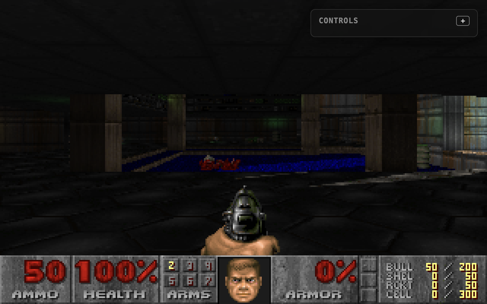

# wDoom

Play it in the browser at **[wdoom.com](https://wdoom.com)**.



wDoom is a Rust port of Doom with a hardware `wgpu` 3D renderer, baked path-traced lightmaps, 3D voxel models, and PBR materials. It compiles both as a native desktop app and to WebAssembly for the browser.

## What it does

- **Hardware 3D renderer (`wgpu`)**: Renders Doom level geometry directly on the GPU instead of blitting a software framebuffer, while keeping the classic Doom viewport feel and status bar.
- **Baked path-traced lighting**: Levels can be path-traced natively and saved as sparse `.rmlt` lightmaps. In play mode, baked global illumination blends with classic Doom sector lighting and distance diminishing.
- **3D voxel models**: Enemies, barrels, pickups, and props are rendered from `.kvx` voxel models using a greedy mesher.
- **Materials and post-processing**: Normal/roughness/metallic maps, emissive brightmaps, SSAO, optional Screen-Space Radiance Cascades (SSRC), 4x MSAA, and post-pixelization SMAA.
- **Resolution downsampling**: Toggleable 100%, 1/2, and 1/4 resolution modes that downsample wall/flat/sprite textures, baked lightmaps, and voxel geometry together.
- **Audio**: Stereo-panned SFX via `rodio` and Roland SC-55 SoundFont music via `rustysynth` (pass `-sf2 <path>` to use a different SoundFont).

## Controls (web)

The collapsible controls panel on the right lets you toggle and tune rendering live:

- **Buttons**: `Bake` (`[` / `F6`), `Map` (`Tab`), `Pause` (`P` / `M`), `SSRC` (`]` / `F5`), `Clear` (`F8`), `MSAA` (`\` / `F7`), `SMAA` (`0`), and `Tex` (`100%` / `1/2` / `1/4`).
- **Sliders**: `Blend`, `Objects`, `Diminish`, `Bounce`, `Bump`, `Rough`, and `SSRC`.

## Running natively

Requires a Rust toolchain (stable) and a Doom WAD (`doom1.wad` is included; commercial WADs like `doom.wad` or `doom2.wad` also work).

```bash
cargo run --release -- -iwad doom1.wad
```

Any arguments after `--` are passed straight to the engine. Native builds include an `egui` panel for baking lightmaps into `.savegame/`.

## Building the web version

```bash
wasm-pack build --target web --out-dir ../web/pkg room
python3 -m http.server 8000 --directory web
```

To package a static release into `web-dist/` with verified bakes:

```bash
python3 tools/web_release.py package --keys <bake-keys-file>
python3 tools/web_release.py build
```

## Repo layout

- `room/src/doom/` - Rust port of the Doom engine modules
- `room/src/gpu.rs`, `room/src/hw.rs` - `wgpu` 3D renderer, lightmap baking, and scene meshing
- `room/src/voxel.rs` - `.kvx` loader, downsampler, and greedy mesher
- `room/src/pbr.rs`, `room/src/brightmaps.rs` - surface materials and emissive masks
- `room/src/web.rs`, `web/` - WebAssembly entry points and browser UI
- `tools/web_release.py`, `web-dist/` - release packager and static web build

## License

The engine source code is licensed under **GPL-2.0** (see `LICENSE-GPL-2.0`), built on id Software's DOOM, [doomgeneric](https://github.com/ozkl/doomgeneric), and [room](https://github.com/sunsided/room).

The bundled `doom1.wad` is the unmodified DOOM shareware v1.0 IWAD, Copyright (c) 1993 id Software, Inc. It is not covered by the GPL and is distributed under its own shareware terms (`LICENSE-DOOM1`). Commercial IWADs are not included.
