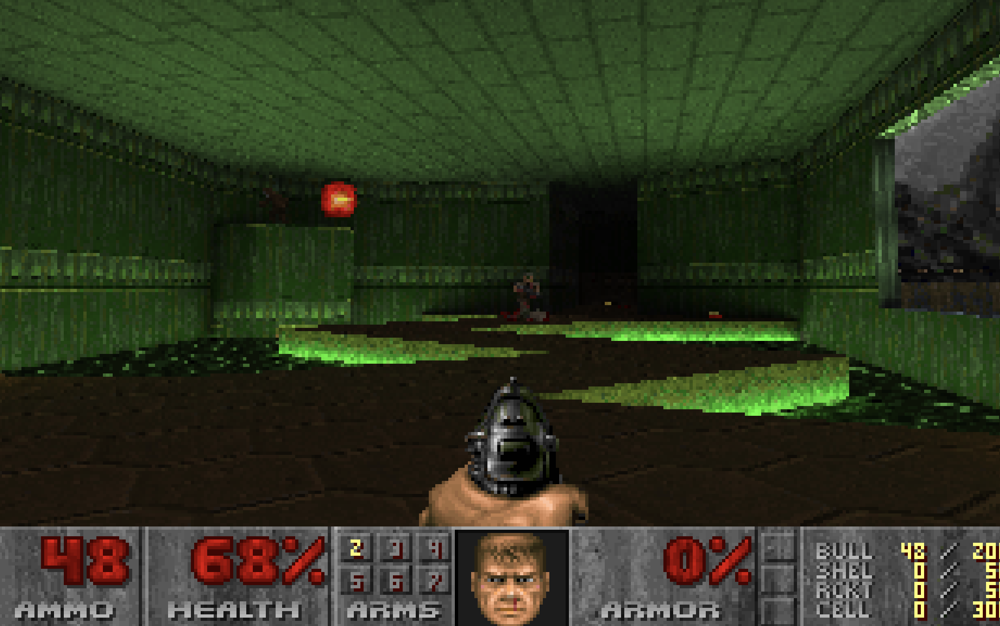
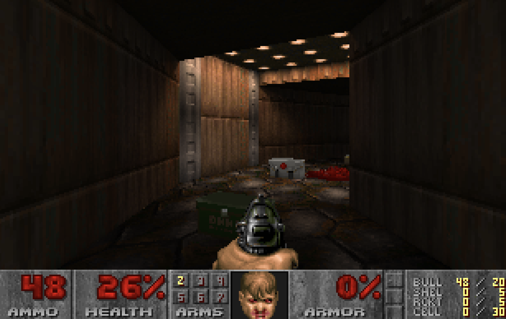
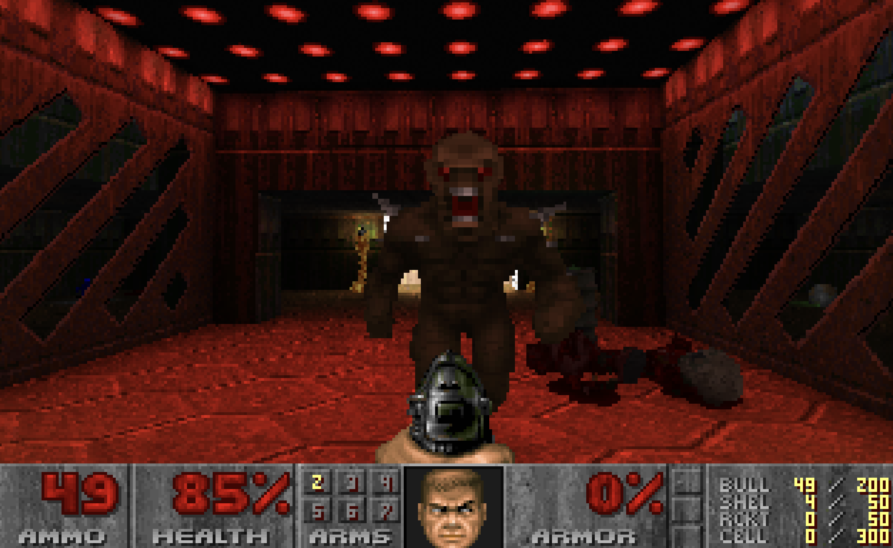
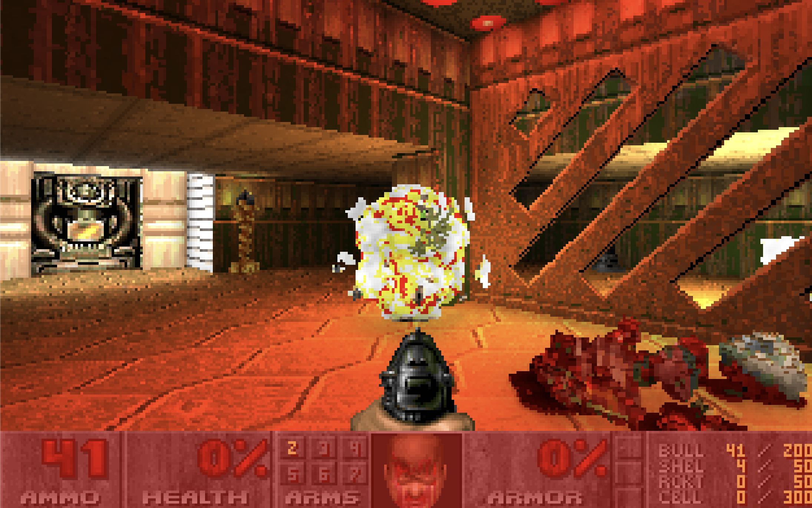

# wDoom

Play it in the browser at [wdoom.com](https://wdoom.com).

wDoom is a Rust port of Doom for desktop and browsers. It uses `wgpu` to draw Doom maps in 3D with baked path-traced lighting, voxel models, and PBR materials.

## Screenshots

<p>
  
  
</p>
<p>
  
  
</p>

## Renderer and audio

- Baked `.rmlt` lightmaps blend with Doom's sector lighting and distance falloff.
- Enemies, pickups, barrels, and props use `.kvx` voxel models where available.
- The renderer supports normal, roughness, and metallic maps, emissive brightmaps, SSAO, optional Screen-Space Radiance Cascades (SSRC), 4× MSAA, and SMAA.
- The texture setting scales walls, flats, sprites, lightmaps, and voxel geometry together at full, half, or quarter resolution.
- `rodio` plays stereo-panned sound effects. `rustysynth` plays music with a Roland SC-55 SoundFont. Pass `-sf2 <path>` to use a different SoundFont in a native build.

## Browser controls

Open the panel on the right to change rendering settings during play. Use `Tab` for the map and `P` or `M` to pause.

| Action | Shortcut |
| --- | --- |
| Bake | `[` or `F6` |
| Toggle SSRC | `]` or `F5` |
| Clear | `F8` |
| Toggle MSAA | <kbd>&#92;</kbd> or `F7` |
| Toggle SMAA | `0` |

Use **Tex** to switch resolution. The sliders control Blend, Objects, Diminish, Bounce, Bump, Rough, and SSRC.

## Running natively

Use stable Rust and the included `doom1.wad`. You can also supply your own `doom.wad` or `doom2.wad`.

```bash
cargo run --release -- -iwad doom1.wad
```

Any arguments after `--` are passed straight to the engine. Native builds include an `egui` panel for baking lightmaps into `.savegame/`.

## Building the web version

```bash
wasm-pack build --target web --out-dir ../web/pkg room
python3 -m http.server 8000 --directory web
```

These commands package a static release with verified bakes in `web-dist/`.

```bash
python3 tools/web_release.py package --keys <bake-keys-file>
python3 tools/web_release.py build
```

## Repo layout

- `room/src/doom/` - Rust port of the Doom engine modules
- `room/src/gpu.rs`, `room/src/hw.rs` - `wgpu` 3D renderer, lightmap baking, and scene meshing
- `room/src/voxel.rs` - `.kvx` loader, downsampler, and greedy mesher
- `room/src/pbr.rs`, `room/src/brightmaps.rs` - surface materials and emissive masks
- `room/src/web.rs`, `web/` - WebAssembly entry points and browser UI
- `tools/web_release.py`, `web-dist/` - release packager and static web build

## License

The engine source code is licensed under **GPL-2.0** ([license](LICENSE-GPL-2.0)), built on id Software's DOOM, [doomgeneric](https://github.com/ozkl/doomgeneric), and [room](https://github.com/sunsided/room).

The bundled `doom1.wad` is the unmodified DOOM shareware v1.0 IWAD, Copyright (c) 1993 id Software, Inc. It is not covered by the GPL and is distributed under its own shareware terms ([license](web-dist/LICENSE-DOOM1)). Commercial IWADs are not included.
